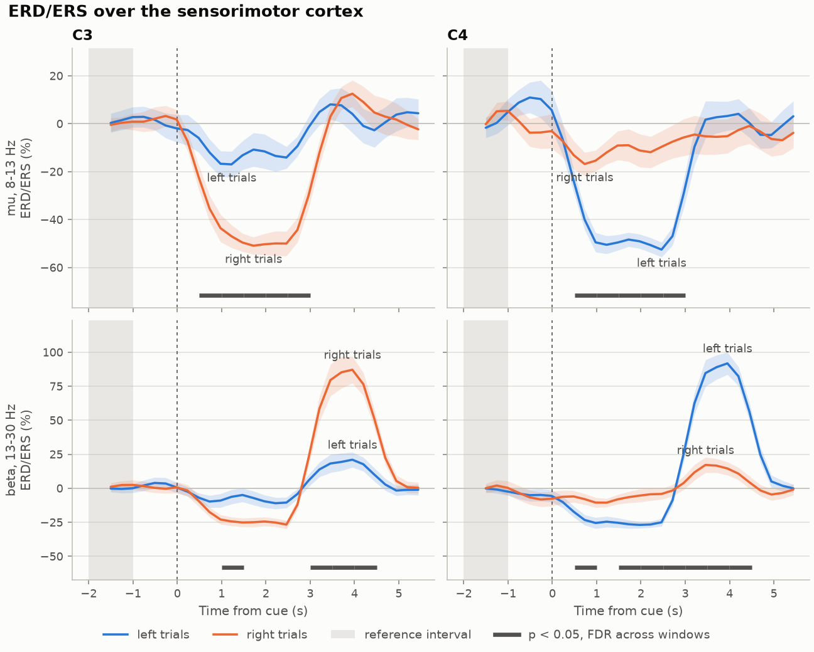
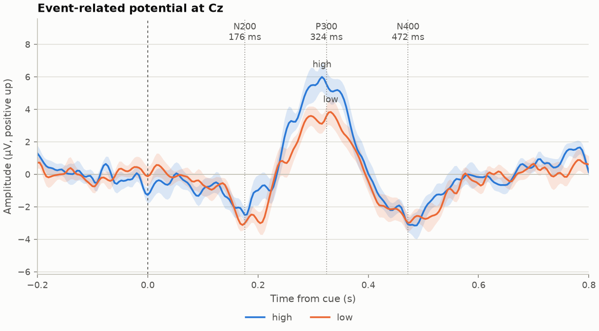
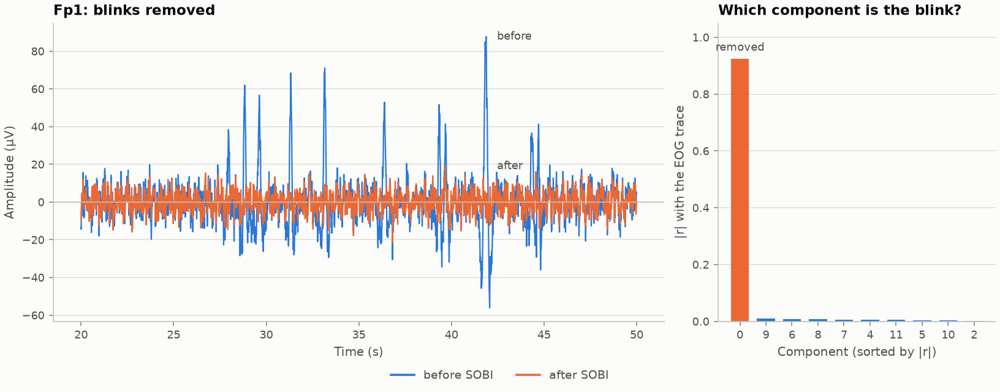
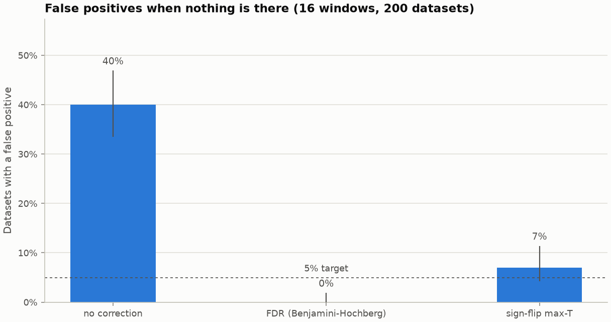

# eeg-erds

[](https://github.com/juanbezerra1/eeg-erds/actions/workflows/ci.yml)


*Leia em português: [README.pt-BR.md](README.pt-BR.md)*

**ERD/ERS, ERP peaks, SOBI blink removal and epoch rejection for epoched EEG, with a synthetic
generator that knows the truth.**

Motor-imagery and cognitive EEG studies often have 8-20 participants, and the classic analyses are
easy to get slightly wrong: band-passing each epoch separately bends its edges, one noisy reference
interval shifts a whole ERD curve, thirty windows tested at 5% will "find" something, and the peak
of a noisy waveform is always positive. `eegerds` implements these steps in a few small modules and
tests every one of them against simulated recordings whose ERD curve, ERP latency, blink signal and
contaminated trials are known, so each claim below is a number you can reproduce.

| | |
|---|---|
| `erds_curve`, `erds_group` | ERD/ERS in percent of a reference power, by inter-trial variance (induced activity only) or classical power; windows, reference and smoothing are explicit |
| `sobi`, `remove_eog_components` | SOBI blind source separation and blink-component removal by correlation with an EOG trace; a recording without blinks is left untouched |
| `reject_epochs` | three explicit rules (sustained deflection, share of samples out, absolute amplitude) plus an optional window-variance rule; the report lists the rules that flagged each epoch and how many epochs each channel broke |
| `find_peaks_ordered`, `group_erp`, `measure_amplitudes` | N200/P300/N400 searched in order, latency from the pooled group average, amplitude measured at that latency |
| `compare_conditions`, `compare_channels`, `compare_amplitudes` | paired tests across subjects with the smallest attainable p-value (`p_floor`) in every row; Wilcoxon + FDR, or an exact sign-flip max-T that controls the family-wise error |
| `trial_features` | one row per epoch of log power ratios, in the CSV layout read by [`subjectwise`](https://github.com/juanbezerra1/subjectwise-ml) |
| `simulate_group`, `expected_erds` | synthetic 12-channel recordings with blinks, mains noise and artefacts, and the exact expected ERD/ERS curve |
| `process_recording` | notch, band-pass, blink removal, epoching, baseline and rejection in one call, with every intermediate result returned |

## Try it

```bash
pip install git+https://github.com/juanbezerra1/eeg-erds.git
eegerds demo --out demo            # about 10 s; add --quick for a smoke test
```

The demo simulates 10 subjects (10 trials per condition, left/right hand x high/low load), runs the
whole pipeline, compares the results with the known truth and writes `report.md`, three figures and
CSV tables to `demo/`. With seed 0:

| what | estimated | truth |
|---|---:|---:|
| mu ERD, contralateral (C4, left-hand trials), 0.75-2.75 s | -50.7% | -52.5% |
| mu ERD, ipsilateral (C3, left-hand trials) | -14.1% | -13.1% |
| beta rebound, contralateral (C4, left hand), 3.25-4.25 s | +91.2% | +87.9% |
| P300 latency at Cz | 324 ms | 318 ms |
| Fp1 correlation with the true blink signal | 0.69 before, 0.01 after SOBI | 0 |
| contaminated epochs caught (33 of 400) | 61% with the three amplitude rules, 100% with the variance rule | all |
| clean epochs rejected by mistake | 0 of 367 | 0 |



The bars at the bottom of each panel mark the half-second windows where left and right trials differ
(Wilcoxon, FDR over the 32 tests of each band: 2 channels x 16 windows; 10 of 32 in mu and 11 of 32
in beta). The same data give an ERP with the three components found automatically:



and the blink component that SOBI removed, picked out of 12 by its correlation with the EOG trace:



## How many false positives to expect

With a handful of subjects and dozens of windows, the testing rule decides what you will "find".
`examples/false_positive_windows.py` simulates 200 experiments in which left and right trials are
*identical* at C3 (both hemispheres desynchronise equally), runs each through the full pipeline,
and tests 16 half-second windows with 8 subjects:



Uncorrected Wilcoxon tests call something significant in 40% of the experiments (80 of 200; 95%
interval 33-47%). The sign-flip max-T test, which is exact for up to 12 subjects, gives 7% (14 of
200; 4-11%), compatible with the nominal 5%. Benjamini-Hochberg gave none (0 of 200), which sounds
good until you see why: with 8 subjects the smallest exact Wilcoxon p-value is 2/2^8 = 0.0078, so
FDR over 16 windows can only reject if several windows sit at that floor together. Every table
carries a `p_floor` column so you can see when a correction has no room to work.

## Use it on your own data

Epochs are `(n_epochs, n_channels, n_times)` arrays **in volts** with labels such as `"left/high"`
(tags joined by `/`, MNE-style). Save them as `.npz` with `ee.save_epochs`, read an `mne.Epochs` with
`ee.from_mne`, or give `.fif` files straight to the command line:

```bash
eegerds erds S*.npz --tag-a left --tag-b right --channel C3 --channel C4 --out erds_windows.csv
eegerds peaks S*.npz --channel Cz --tag-a high --tag-b low --out erp_components.csv
eegerds features S*.npz --class left --class right --out features.csv
eegerds simulate sim_epochs --subjects 10        # synthetic epochs, to try the commands above
```

or from Python:

```python
import eegerds as ee

epochs = [ee.load_epochs(p) for p in ("S01.npz", "S02.npz", "S03.npz")]

cfg = ee.ErdsConfig(band=(8, 13), window=0.5, overlap=0.0, reference=(-2, -1))
left = ee.erds_group([e.select("left") for e in epochs], cfg)
right = ee.erds_group([e.select("right") for e in epochs], cfg)
table = ee.compare_conditions(left, right, ["C3", "C4"], method="signflip_maxt")
print(table[["series", "t_start", "t_stop", "mean_a", "mean_b", "p_adj", "p_floor"]])
```

From a continuous recording, one call does the cleaning (the events are `(sample, code)` rows and
`event_labels` maps codes to labels):

```python
rec = ee.Recording(
    data,  # (n_channels, n_samples), volts
    fs=500.0,
    ch_names=("Fp1", "Fp2", "C3", "Cz", "C4", "Oz"),
    events=events,
    event_labels={1: "left/low", 2: "right/high"},
    eog=eog,  # optional dedicated EOG channel, same length as the data
    subject="P01",
)
cfg = ee.PipelineConfig(rejection=ee.RejectionConfig(max_window_sd_ratio=3.0))
result = ee.process_recording(rec, cfg)
print(result.report.counts(), result.eog.removed)  # which rule dropped how many; which component
epochs = result.epochs  # clean, baseline-corrected epochs
```

For the most exact ERD/ERS, filter the *continuous* signal in the band of interest, then epoch it,
then tell `erds` the data are already filtered (see the first limit below):

```python
mu = ee.bandpass_recording(result.cleaned, 8, 13)
epochs = ee.epoch(mu, -2.0, 6.0, baseline=(-2.0, 0.0))
curve = ee.erds_curve(epochs.select("left"), ee.ErdsConfig(band=(8, 13), prefiltered=True))
```

`examples/quickstart.py` runs the whole tour on synthetic data in about ten seconds.

### Together with the sibling projects

`eegerds features` writes the same table layout as [`biosigkit`](https://github.com/juanbezerra1/biosigkit)
(`subject`, `level`, `trial`, then numeric `<channel>_<feature>` columns), so the file goes straight
into [`subjectwise`](https://github.com/juanbezerra1/subjectwise-ml) for a leave-one-subject-out
accuracy instead of the optimistic one from a random split of epochs:

```bash
eegerds demo --out demo
subjectwise evaluate demo/features.csv --label level --group subject
```

On the demo's 367 trials, LDA reaches 92% left-vs-right accuracy leave-one-subject-out (SD 5 points
across the 10 subjects), and a permutation test that shuffles the labels inside each subject gives
p = 0.005. A random split of epochs also gives 92%: the simulated effect is shared by every subject,
so there is nothing for a random split to leak. On real data the two numbers often differ, which is
the reason to check.

## Design decisions and honest limits

* **Filtering each epoch separately bends its edges.** A narrow band has a long memory: on noise
  with a known spectrum, band-passing 8 s epochs one by one makes the power in the last half second
  18% too low. `erds` pads each epoch by one second, which cuts that to about 4%; the exact way is
  `bandpass_recording` on the continuous signal and `ErdsConfig(prefiltered=True)`.
  **`prefiltered=True` on data that are not limited to the band measures broadband power**, and
  the mu ERD comes out about 20% instead of 48% in the tests. The default is the safe setting.
* **One reference interval shifts the whole curve.** Every window is divided by the same reference
  power, so its estimation error is a common multiplicative error (about 12% for a narrow band, 60
  epochs and a 1 s reference). Prefer a longer reference and many epochs.
* **Smoothing is for display only.** Overlapping windows and smoothing make neighbours dependent;
  `compare_*` should get unsmoothed, non-overlapping windows (the CLI does this).
* **The three amplitude rules miss noise-like bursts.** On simulated contamination (25% of trials,
  8 subjects, three seeds) they caught 62-70%; the optional `max_window_sd_ratio=3` rule raised that
  to 97-100% with no clean epoch rejected. It is off by default because the right ratio depends on
  your data: read the rejection report instead of trusting a rate.
* **Small ERP components are fragile.** In the demo the N200 (about -2 µV) comes out at 176 ms at
  Cz against a truth of 198 ms, and at 132 ms at Pz. The P300 and the group-level pipeline are
  reliable; a per-subject N200 would not be. Amplitudes are read at the *group* latency, from the
  pooled average of all conditions (which is blind to the contrast), because the maximum of a noisy
  waveform is positive even in pure noise.
* **With 6-8 subjects the test, not the effect, sets the floor.** See the false-positive study
  above; `p_floor` is in every table.
* **SOBI removes what correlates with the EOG, and a bit more.** The component also carries some
  slow frontal background, which goes with it. With one EOG trace only one kind of artefact is
  targeted, and SOBI needs enough samples (at least 10 per channel).
* **Everything here was checked on synthetic data.** The generator is a model of what the *methods*
  do (it is Gaussian, stationary apart from the ERD envelope, and has no volume conduction beyond a
  simple projection), not of the brain. It makes claims about this code checkable; it does not
  validate them on real recordings.

More detail, with formulas and the measurements behind these numbers:
[`docs/method.md`](docs/method.md).

## Development

```bash
pip install -e ".[dev]"
pytest                                   # tests, including the demo and the CLI
ruff check . && ruff format --check . && mypy src
```

CI runs the tests on Python 3.10-3.13 (Linux) and on Python 3.10 and 3.13 (Windows), once with the oldest
allowed version of every direct dependency, lint and types, and installs the built wheel in a clean
environment (Linux and Windows) to run `eegerds demo --quick`.

## Related

* [`biosigkit`](https://github.com/juanbezerra1/biosigkit): EMG/force trials to feature tables.
* [`subjectwise`](https://github.com/juanbezerra1/subjectwise-ml): honest validation of classifiers
  trained on a handful of subjects.

## License

MIT, see [LICENSE](LICENSE).
