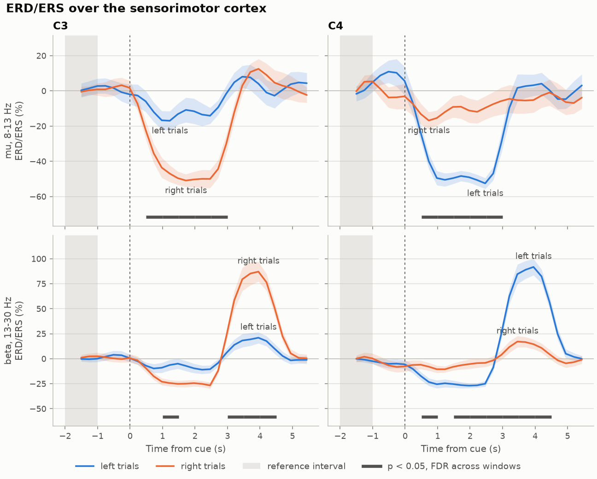
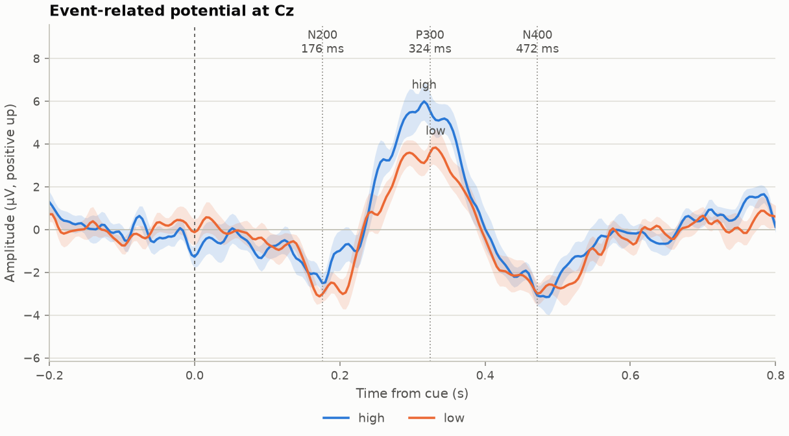
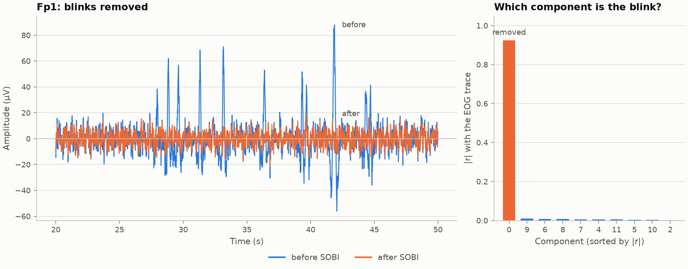
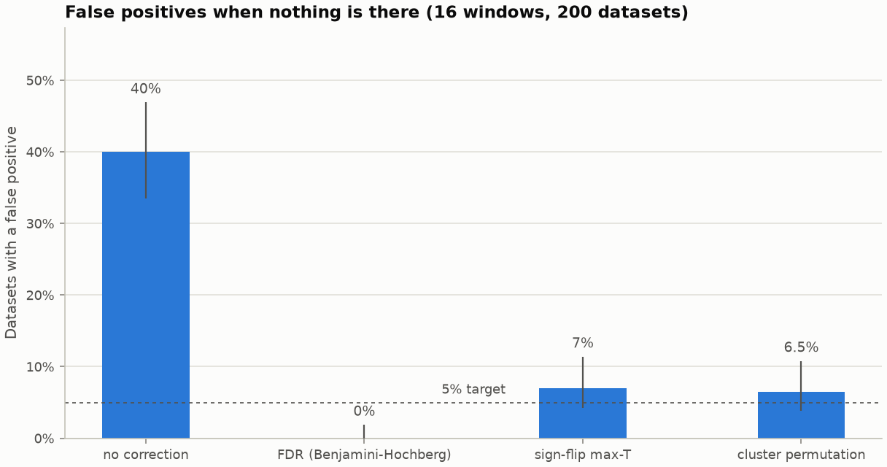

# eeg-erds

[](https://github.com/juanbezerra1/eeg-erds/actions/workflows/ci.yml)


*Read in English: [README.md](README.md)*

**ERD/ERS, picos de ERP, remoção de piscadas por SOBI e rejeição de épocas para EEG segmentado,
com um gerador sintético que conhece a resposta certa.**

Estudos de EEG com imaginação motora ou tarefas cognitivas costumam ter de 8 a 20 participantes, e
as análises clássicas são fáceis de errar um pouco: filtrar cada época separadamente deforma as
bordas dela, um único intervalo de referência ruidoso desloca a curva de ERD inteira, trinta janelas
testadas a 5% sempre "encontram" alguma coisa, e o pico de uma onda ruidosa é sempre positivo.
O `eegerds` implementa esses passos em poucos módulos pequenos e testa cada um deles contra
gravações simuladas cujo ERD, latência de ERP, sinal de piscada e tentativas contaminadas são
conhecidos. Por isso cada afirmação abaixo é um número que você pode reproduzir.

| | |
|---|---|
| `erds_curve`, `erds_group` | ERD/ERS em porcentagem da potência de referência, por variância entre tentativas (só a atividade induzida) ou por potência clássica; janelas, referência e suavização são explícitas |
| `sobi`, `remove_eog_components` | separação cega de fontes por SOBI e remoção do componente de piscada pela correlação com o EOG; uma gravação sem piscadas fica intacta |
| `reject_epochs` | três regras explícitas (deflexão sustentada, fração de amostras fora do limite, amplitude absoluta) mais uma regra opcional de variância por janela; o relatório lista as regras que sinalizaram cada época e em quantas épocas cada canal quebrou regras |
| `find_peaks_ordered`, `group_erp`, `measure_amplitudes` | N200/P300/N400 buscados em ordem, latência tirada da média do grupo, amplitude medida nessa latência |
| `compare_conditions`, `compare_channels`, `compare_amplitudes` | testes pareados entre sujeitos, com o menor p-valor possível (`p_floor`) em cada linha; Wilcoxon + FDR, sign-flip max-T exato, que controla o erro por família, ou (para janelas) teste de permutação por clusters |
| `trial_features` | uma linha por época, com razões logarítmicas de potência, no formato de CSV lido pelo [`subjectwise`](https://github.com/juanbezerra1/subjectwise-ml) |
| `simulate_group`, `expected_erds` | gravações sintéticas de 12 canais com piscadas, ruído de rede e artefatos, e a curva exata de ERD/ERS esperada |
| `process_recording` | notch, passa-banda, remoção de piscadas, épocas, linha de base e rejeição numa chamada só, devolvendo todos os resultados intermediários |

## Experimente

```bash
pip install git+https://github.com/juanbezerra1/eeg-erds.git
eegerds demo --out demo            # cerca de 10 s; com --quick vira um teste rápido
```

O demo simula 10 sujeitos (10 tentativas por condição, mão esquerda/direita x carga alta/baixa),
roda o pipeline inteiro, compara os resultados com a verdade conhecida e grava em `demo/` um
`report.md`, três figuras e tabelas em CSV. Com a semente 0:

| o quê | estimado | verdade |
|---|---:|---:|
| ERD de mu, contralateral (C4, tentativas de mão esquerda), 0,75-2,75 s | -50,7% | -52,5% |
| ERD de mu, ipsilateral (C3, tentativas de mão esquerda) | -14,1% | -13,1% |
| rebote de beta, contralateral (C4, mão esquerda), 3,25-4,25 s | +91,2% | +87,9% |
| latência do P300 em Cz | 324 ms | 318 ms |
| correlação de Fp1 com o sinal verdadeiro de piscada | 0,69 antes, 0,01 depois do SOBI | 0 |
| épocas contaminadas pegas (33 de 400) | 61% com as três regras de amplitude, 100% com a regra de variância | todas |
| épocas limpas rejeitadas por engano | 0 de 367 | 0 |



As barras na base de cada painel marcam as janelas de meio segundo em que as tentativas de mão
esquerda e direita diferem (Wilcoxon, FDR sobre os 32 testes de cada banda: 2 canais x 16 janelas;
10 de 32 em mu e 11 de 32 em beta). Os mesmos dados dão um ERP com os três componentes achados
automaticamente:



e o componente de piscada que o SOBI removeu, escolhido entre 12 pela correlação com o EOG:



## Quantos falsos positivos esperar

Com poucos sujeitos e dezenas de janelas, a regra de teste decide o que você vai "encontrar".
`examples/false_positive_windows.py` simula 200 experimentos em que as tentativas de mão esquerda e
direita são *idênticas* em C3 (os dois hemisférios dessincronizam igual), passa cada um pelo
pipeline completo e testa 16 janelas de meio segundo com 8 sujeitos:



Testes de Wilcoxon sem correção acham algo significativo em 40% dos experimentos (80 de 200;
intervalo de 95%: 33-47%). O teste sign-flip max-T, exato para até 12 sujeitos, dá 7% (14 de 200;
4-11%), e o teste de permutação por clusters (`method="cluster"`) dá 6,5% (13 de 200; 4-11%): os
dois compatíveis com os 5% nominais. O Benjamini-Hochberg não deu nenhum (0 de 200), o que parece
ótimo até você ver o porquê: com 8 sujeitos o menor p-valor exato do Wilcoxon é 2/2^8 = 0,0078, então
o FDR sobre 16 janelas só consegue rejeitar quando várias janelas estão nesse piso ao mesmo tempo.
Toda tabela traz uma coluna `p_floor` para você ver quando uma correção não tem espaço para agir.

**Max-T ou clusters?** Os dois controlam o mesmo erro, mas gastam o poder de modo diferente. Nas
simulações de `tests/test_cluster.py` (8 sujeitos, 16 janelas, ruído correlacionado entre janelas
vizinhas, 150 experimentos cada), um efeito fraco espalhado por seis janelas (pico: 1,2 desvio
padrão) foi achado pelo teste de clusters em 69% dos experimentos e pelo max-T em 45% (FDR: 17%);
um efeito de 2 desvios padrão numa única janela foi achado pelo teste de clusters em 28% e pelo
max-T em 85% (FDR: 1%). Então use clusters para uma ERD lenta e larga, e max-T para uma janela
pontual. O que o teste de clusters estabelece é que as condições diferem *em algum ponto* dos
dados testados: o cluster é a evidência, não uma fronteira medida, então ele não diz que cada
janela dele difere, nem onde o efeito começa e termina ([`docs/method.md`](docs/method.md),
seção 6, em inglês).

## Use nos seus dados

As épocas são arrays `(n_epocas, n_canais, n_tempos)` **em volts**, com rótulos como `"left/high"`
(tags separadas por `/`, no estilo do MNE). Salve-as em `.npz` com `ee.save_epochs`, leia um
`mne.Epochs` com `ee.from_mne`, ou passe arquivos `.fif` direto para a linha de comando:

```bash
eegerds erds S*.npz --tag-a left --tag-b right --channel C3 --channel C4 --out erds_windows.csv
eegerds peaks S*.npz --channel Cz --tag-a high --tag-b low --out erp_components.csv
eegerds features S*.npz --class left --class right --out features.csv
eegerds simulate sim_epochs --subjects 10        # épocas sintéticas, para testar os comandos acima
```

ou pelo Python:

```python
import eegerds as ee

epochs = [ee.load_epochs(p) for p in ("S01.npz", "S02.npz", "S03.npz")]

cfg = ee.ErdsConfig(band=(8, 13), window=0.5, overlap=0.0, reference=(-2, -1))
left = ee.erds_group([e.select("left") for e in epochs], cfg)
right = ee.erds_group([e.select("right") for e in epochs], cfg)
table = ee.compare_conditions(left, right, ["C3", "C4"], method="signflip_maxt")
print(table[["series", "t_start", "t_stop", "mean_a", "mean_b", "p_adj", "p_floor"]])

# para um efeito largo: clusters de janelas vizinhas (acrescenta `cluster` e `cluster_mass`);
# na linha de comando é `--method cluster`
clusters = ee.compare_conditions(left, right, ["C3", "C4"], method="cluster")
```

A partir de uma gravação contínua, uma chamada faz a limpeza (os eventos são linhas
`(amostra, código)` e `event_labels` liga cada código a um rótulo):

```python
rec = ee.Recording(
    data,  # (n_canais, n_amostras), em volts
    fs=500.0,
    ch_names=("Fp1", "Fp2", "C3", "Cz", "C4", "Oz"),
    events=events,
    event_labels={1: "left/low", 2: "right/high"},
    eog=eog,  # canal de EOG dedicado, com o mesmo comprimento dos dados
    subject="P01",
)
cfg = ee.PipelineConfig(rejection=ee.RejectionConfig(max_window_sd_ratio=3.0))
result = ee.process_recording(rec, cfg)
print(result.report.counts(), result.eog.removed)  # épocas por regra; componente removido
epochs = result.epochs  # épocas limpas, com linha de base corrigida
```

Para o ERD/ERS mais exato, filtre o sinal *contínuo* na banda de interesse, depois segmente, e só
então avise o `erds` de que os dados já estão filtrados (veja o primeiro limite abaixo):

```python
mu = ee.bandpass_recording(result.cleaned, 8, 13)
epochs = ee.epoch(mu, -2.0, 6.0, baseline=(-2.0, 0.0))
curve = ee.erds_curve(epochs.select("left"), ee.ErdsConfig(band=(8, 13), prefiltered=True))
```

O `examples/quickstart.py` faz todo esse passeio com dados sintéticos em cerca de dez segundos.

### Junto com os projetos irmãos

O `eegerds features` grava a mesma estrutura de tabela do
[`biosigkit`](https://github.com/juanbezerra1/biosigkit) (`subject`, `level`, `trial` e depois colunas
numéricas `<canal>_<feature>`), então o arquivo entra direto no
[`subjectwise`](https://github.com/juanbezerra1/subjectwise-ml), que dá a acurácia
leave-one-subject-out em vez da otimista que vem de uma divisão aleatória de épocas:

```bash
eegerds demo --out demo
subjectwise evaluate demo/features.csv --label level --group subject
```

Nas 367 tentativas do demo, o LDA chega a 92% de acerto esquerda-vs-direita
leave-one-subject-out (desvio de 5 pontos entre os 10 sujeitos), e um teste de permutação que
embaralha os rótulos dentro de cada sujeito dá p = 0,005. Uma divisão aleatória de épocas também dá
92%: o efeito simulado é compartilhado por todos os sujeitos, então não há o que uma divisão
aleatória vazar. Em dados reais os dois números costumam divergir, e é por isso que vale conferir.

## Decisões de projeto e limites honestos

* **Filtrar cada época separadamente deforma as bordas dela.** Uma banda estreita tem memória
  longa: em ruído com espectro conhecido, passar-banda em épocas de 8 s uma a uma deixa a potência
  do último meio segundo 18% baixa demais. O `erds` acrescenta um segundo de margem a cada época, o
  que reduz isso para cerca de 4%; o jeito exato é `bandpass_recording` no sinal contínuo e
  `ErdsConfig(prefiltered=True)`. **`prefiltered=True` em dados que não estão limitados à banda mede
  potência de banda larga**, e o ERD de mu sai cerca de 20% em vez de 48% nos testes. O padrão é o
  ajuste seguro.
* **Um único intervalo de referência desloca a curva inteira.** Toda janela é dividida pela mesma
  potência de referência, então o erro de estimá-la é um erro multiplicativo comum (cerca de 12%
  para uma banda estreita, 60 épocas e 1 s de referência). Prefira uma referência mais longa e
  muitas épocas.
* **A suavização é só para exibir.** Janelas sobrepostas e suavização tornam as vizinhas
  dependentes; o `compare_*` deve receber janelas sem suavização e sem sobreposição (a linha de
  comando faz isso).
* **As três regras de amplitude deixam passar rajadas de ruído.** Em contaminação simulada (25% das
  tentativas, 8 sujeitos, três sementes) elas pegaram 62-70%; a regra opcional
  `max_window_sd_ratio=3` subiu isso para 97-100%, sem rejeitar nenhuma época limpa. Ela vem
  desligada porque a razão certa depende dos seus dados: leia o relatório de rejeição em vez de
  confiar em uma taxa.
* **Componentes pequenos de ERP são frágeis.** No demo, o N200 (cerca de -2 µV) sai em 176 ms em Cz
  contra uma verdade de 198 ms, e em 132 ms em Pz. O P300 e o pipeline de grupo são confiáveis; um
  N200 por sujeito não seria. As amplitudes são lidas na latência do *grupo*, na média de todas as
  condições juntas (que não enxerga o contraste), porque o máximo de uma onda ruidosa é positivo
  até em ruído puro.
* **Com 6-8 sujeitos o piso vem do teste, não do efeito.** Veja o estudo de falsos positivos acima;
  o `p_floor` está em toda tabela.
* **O SOBI remove o que correlaciona com o EOG, e um pouco mais.** O componente também carrega parte
  do fundo lento frontal, que vai junto. Com um único canal de EOG só um tipo de artefato é visado, e
  o SOBI precisa de amostras suficientes (pelo menos 10 por canal).
* **Tudo aqui foi verificado em dados sintéticos.** O gerador é um modelo do que os *métodos*
  fazem (é gaussiano, estacionário exceto pelo envelope do ERD, e não tem condução de volume além de
  uma projeção simples), não do cérebro. Ele torna as afirmações sobre este código verificáveis; não
  as valida em gravações reais.

Mais detalhes, com as fórmulas e as medições por trás desses números:
[`docs/method.md`](docs/method.md) (em inglês).

## Desenvolvimento

```bash
pip install -e ".[dev]"
pytest                                   # testes, incluindo o demo e a linha de comando
ruff check . && ruff format --check . && mypy src
```

O CI roda os testes em Python 3.10-3.13 (Linux) e em Python 3.10 e 3.13 (Windows), uma vez com a versão mais
antiga permitida de cada dependência direta, o lint e os tipos, e instala o wheel construído num ambiente limpo
(Linux e Windows) para rodar `eegerds demo --quick`.

## Relacionados

* [`biosigkit`](https://github.com/juanbezerra1/biosigkit): de tentativas de EMG/força a tabelas de
  features.
* [`subjectwise`](https://github.com/juanbezerra1/subjectwise-ml): validação honesta de classificadores
  treinados com poucos sujeitos.

## Licença

MIT, veja [LICENSE](LICENSE).
